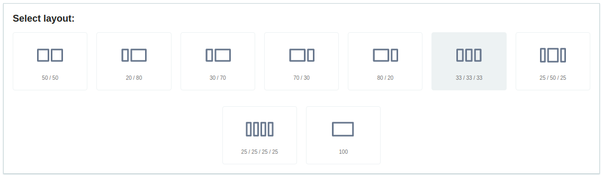
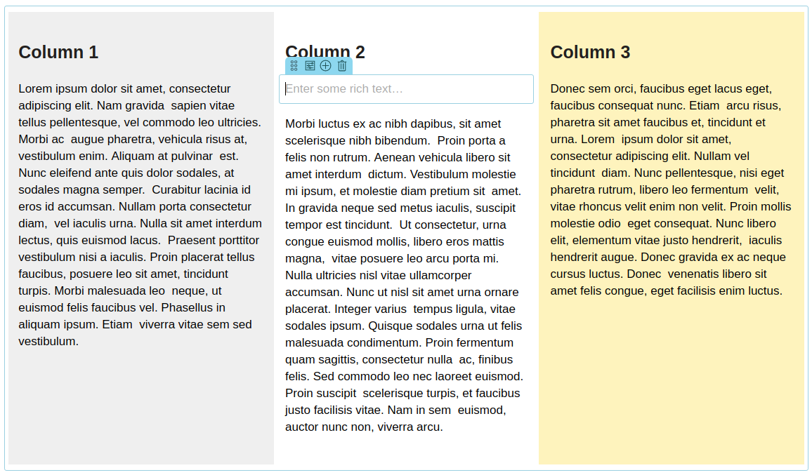
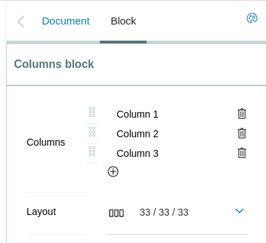
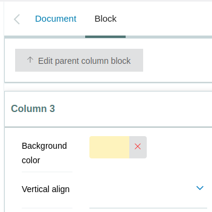
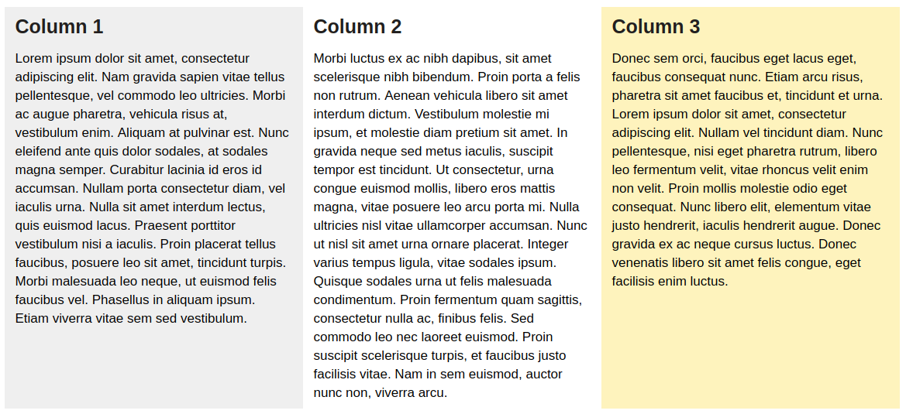

# @eeacms/volto-columns-block

[](https://github.com/eea/volto-columns-block/releases)
[](https://ci.eionet.europa.eu/view/Github/job/volto-addons/job/volto-columns-block/job/master/display/redirect)
[](https://sonarqube.eea.europa.eu/dashboard?id=volto-columns-block)

[Volto](https://github.com/plone/volto) add-on

## Features

This package gives you a block with columns. Each column is its own separate
blocks container.







## Requirements

### Backend

- [Plone](https://plone.org/download)
- [plone.restapi](https://pypi.org/project/plone.restapi/)

### Frontend

- Node.js: `>=22.0.0`

## Installation

For Volto 18 and newer, create projects with Cookieplone. See the official
Plone documentation:
[Install Plone with Cookieplone](https://6.docs.plone.org/install/create-project-cookieplone.html)
and
[Install an add-on in Volto 18 and 19](https://6.docs.plone.org/volto/development/add-ons/install-an-add-on.html).

1. If you do not already have a project, create one:

   ```
   uvx cookieplone project
   cd project-title
   make install
   ```

1. Install the add-on in your Volto project:

   ```
   pnpm --filter <name-of-your-policy-add-on> add @eeacms/volto-columns-block
   ```

1. Add the add-on to `volto.config.js`:

   ```JavaScript
   const addons = ['@eeacms/volto-columns-block'];
   ```

1. Start Plone:

   ```
   make backend-start
   make frontend-start
   ```

1. Go to http://localhost:3000

1. Happy editing!

## Upgrade

### Upgrading to 10.x

> This version requires `Volto 18` or `Volto 19` and Node.js 22.

The exports stay the same, but the nested barrels `ColumnsBlock/index.js` and `Widgets/index.js` now use the standard `export { default as X } from` syntax instead of the legacy `export X from` proposal, and the published package moves to `packages/volto-columns-block`.

#### Breaking changes

- **Node.js 22 or newer is required** (`engines.node >= 22`), 9.x declared no engine.
- **React 18 is required.** The package declares `react` and `react-dom` as `^18.2.0` peers, 9.x declared no peers.

### Upgrading to 9.x

> This version requires `Volto >= 17.18` or `Volto 18+`. It removes the custom `EditBlockWrapper` and uses Volto's built-in block chrome provided by `BlocksForm`.

#### Breaking changes

- **Removed `EditBlockWrapper.jsx`.** Any code importing `EditBlockWrapper` from `@eeacms/volto-columns-block` will break. Use Volto's built-in `EditBlockWrapper` from `@plone/volto/components/manage/Blocks/Block/EditBlockWrapper` if you need a custom wrapper.
- **Moved the column-settings button into the block sidebar.** The floating `column.svg` icon button that appeared over each column in edit mode has been removed. Column settings are now accessible directly from the block sidebar via the `ColumnsWidget`.
- **`ColumnsBlockSchema` signature changed.** `ColumnsBlockSchema` now receives a single object `{ intl, formData }` instead of just `intl`. Any code calling `ColumnsBlockSchema(intl)` must be updated to `ColumnsBlockSchema({ intl, formData })`.

## License

See [LICENSE.md](LICENSE.md) for details.

## Funding

[European Environment Agency (EU)](http://eea.europa.eu)
